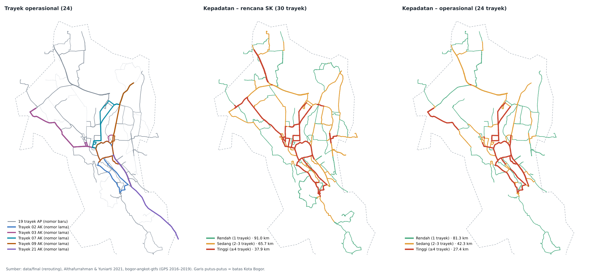

# Data Operasional NAIK — trayek angkot yang benar-benar beroperasi

Folder ini berisi versi **operasional** jaringan angkot Kota Bogor, yaitu 24 trayek yang tercatat
beroperasi di lapangan. Data **rencana SK** (`../final`, 30 trayek hasil rerouting) **tidak diubah**,
jadi keduanya bisa dipakai berdampingan dan dibandingkan.



## Isi folder

| File | Isi |
|---|---|
| `trayek_operasional.geojson` | 48 rute (24 trayek × Berangkat/Pulang), EPSG:4326 |
| `kepadatan_operasional.geojson` | 7.206 ruas jalan + jumlah trayek operasional yang lewat + kelas kepadatan |
| `padanan_nomor_trayek.csv` | Padanan nomor: nomor baru (AP) ↔ nomor lama (AK) ↔ kode Moovit, plus status operasi semua 35 kode |
| `laporan_operasional.csv` | Per trayek: panjang & % tumpang tindih (data vs jurnal), nomor lama, catatan pembentukan |
| `perbandingan_rencana_vs_operasional.csv` | Panjang jalan per kelas kepadatan: rencana SK vs operasional |
| `muat_operasional_qgis.py` | Loader QGIS (+ impor PostGIS ke tabel baru) |
| `bangun_operasional.py` | Script pembentuk semua file di atas (bisa dijalankan ulang) |
| `sumber/` | Data mentah: titik GPS GTFS & daftar rute lama 2016 |

## Cara pakai

**Buka di QGIS**
1. QGIS → Plugins → Python Console → Show Editor → Open Script → `muat_operasional_qgis.py`.
2. Atur `FOLDER` ke folder `data/operasional` di laptop (otomatis kalau script dibuka dari folder ini).
3. Run. Layer masuk ke group **"NAIK – Operasional (jurnal 2021 + GPS)"**:
   - `kepadatan_operasional`: hijau/kuning/merah, warnanya sama dengan aplikasi.
   - `trayek_operasional`: satu warna per trayek. Trayek AK (nomor lama) digambar **putus-putus**.
   - `padanan_nomor_trayek`: tabel atribut.
4. Kalau `KE_POSTGIS = True`, data juga masuk ke PostGIS (koneksi "NAIK ANGKOT") sebagai tabel **baru**:
   `public.trayek_operasional`, `public.kepadatan_operasional`, `public.padanan_nomor_trayek`.
   Tabel lama (`trayek_snapped`, `kepadatan_trayek`, schema `naik`) tidak disentuh.

**Bangun ulang data** (kalau sumber diubah)
```bash
pip install networkx
cd data/operasional
python bangun_operasional.py
```

## Hasil singkat

| Kepadatan | Rencana SK (30 trayek) | Operasional (24 trayek) |
|---|---|---|
| Rendah (1 trayek) | 91,0 km | 81,3 km |
| Sedang (2–3 trayek) | 65,7 km | 42,3 km |
| Tinggi (≥4 trayek) | 37,9 km | 27,4 km |
| **Total** | **194,7 km** | **151,0 km** |

- Ruas tinggi terpanjang: Jl. Raya Pajajaran (±5,1 km), Jl. Letjen Ibrahim Adjie, Jl. Pahlawan,
  Jl. Siliwangi, Jl. A. Yani, Jl. Ir. H. Juanda.
- Ruas paling padat: Jl. R. Saleh S. Bustaman (sekitar BTM), dilewati 12 trayek.
- **% tumpang tindih per trayek** dari data ini dibandingkan dengan jurnal 2021: korelasi **r = 0,87**,
  selisih rata-rata 11 poin persen (rata-rata 72% di data vs 69% di jurnal). Detail ada di
  `laporan_operasional.csv`.

## Metode

1. **Daftar trayek beroperasi** diambil dari survei lapangan di jurnal 2021, ada 24 trayek:
   - **19 trayek AP** (nomor baru hasil rerouting): 01, 02, 03, 05, 08, 09, 10, 13, 14, 15, 17, 18,
     19, 21, 22, 23, 24, 25, 30. Geometrinya diambil dari `../final` (sudah ada).
   - **5 trayek AK** (nomor lama yang belum dialihkan): 02 AK, 03 AK, 07 AK, 09 AK, 21 AK.
     Trayek ini tidak ada di data rencana, jadi dibentuk di sini.
2. **Geometri trayek AK** berasal dari titik GPS hasil naik angkot langsung (feed GTFS bogor-angkot-gtfs):
   - Satu putaran dipecah menjadi Berangkat dan Pulang di titik terminal.
   - Tiap titik dicocokkan ke jaringan jalan berarah (ruas OSM data final + atribut `oneway`).
     Pencocokan memakai map-matching Viterbi: dipilih rangkaian ruas dengan total jalur terpendek
     yang tetap lewat dekat tiap titik GPS.
   - Jalan searah dihormati. Kalau jalur berarah memutar jauh (>1,25× koridor terpendek),
     koridor yang sama dipakai. Ini terjadi misalnya di jalan dua lajur yang hanya satu lajurnya
     ada di jaringan ruas, seperti Jl. Pajajaran utara antara Sobana dan Jambu Dua.
   - Celah presisi antar ruas (kurang dari 2 m, atau komponen terputus ≤15 m, misalnya
     Jl. Ishak Djuarsa–RE Abdullah) disambung dulu supaya jaringannya utuh.
3. **Kepadatan** dihitung ulang hanya dari 24 trayek operasional, dengan kelas yang sama dengan
   aplikasi: 1 trayek = rendah, 2–3 = sedang, ≥4 = tinggi.
4. **Nomor lama** setiap trayek AP ditentukan dari kemiripan jalurnya dengan rute lama (titik GPS
   2016–2019). Satu nomor lama hanya dipasangkan ke satu trayek, yaitu yang skornya tertinggi.

## Soal nomor angkot

Penomoran di lapangan memang campuran:
- **Nomor baru** (AP, sesuai SK rerouting) dipakai di data `../final`.
- Warga dan Moovit sering masih memakai **nomor lama**. Contohnya kesaksian Zaskia:
  - "05" lewat kampus = AK-05, sekarang **03** (Cimahpar – BTM).
  - "08" = AK-08, sekarang **30** (Warung Jambu – BTM).
  - "09" = **09 AK** (Ciparigi – Sukasari). Trayek ini memang masih memakai nomor lama.
- Padanan lengkapnya ada di `padanan_nomor_trayek.csv` (kolom `nomor_lama` & `kode_moovit`).

## Sumber

- Althafurrahman & Yuniarti (2021). *Jurnal Teknik Sipil-Arsitektur* 20(2): 143–146, Tabel 4.1:
  daftar 24 trayek beroperasi, panjang trayek, dan % tumpang tindih (survei 2021).
- SK Wali Kota Bogor 551.2.45-265/2016, Kep. Kadis LLAJ 800/963-DLLAJ (2016), dan
  SK 551.2.45-108.1/2017: dasar rerouting dan nomor baru (data `../final`).
- Michiel de Jong, **bogor-angkot-gtfs** (github.com/michielbdejong/bogor-angkot-gtfs, 2016–2019):
  titik GPS rute AK, file `manual-from-transitwand/kota/shapes.txt`. README repo tersebut menyebut
  CC-0, sedangkan `LICENSE.txt`-nya CC-BY-SA 3.0. Supaya aman, geometri turunan di sini diperlakukan
  sebagai **CC-BY-SA 3.0** dengan atribusi ke Michiel de Jong.
- Moovit (diunduh Nov 2026): kode jalur dan urutan halte, dipakai sebagai pembanding dan padanan nomor.
- OpenStreetMap contributors (ODbL): jaringan jalan dan atribut `oneway`.

## Keterbatasan (perlu cek lapangan 2026)

- **Status operasi berdasarkan survei 2021.** Beberapa trayek di luar daftar jurnal masih tercantum
  di Moovit: 07, 11, 16, 26, 27, 28, 29. Trayek ini tidak dimasukkan dan ditandai sebagai kandidat
  cek lapangan di `padanan_nomor_trayek.csv`.
- **Rute AK berasal dari GPS 2016–2019.** Kalau jalurnya berubah sesudah itu, perlu dicek ulang.
  Untuk 09 AK dan 02 AK, urutan halte di Moovit 2026 masih sejalan.
- **Bagian di luar jaringan ruas kota** digambar lurus antar titik GPS dan tidak ikut dihitung
  kepadatannya (kolom `luar_jaringan_m`):
  - Jl. Gunung Batu (02 AK, 03 AK), ±0,9 km per arah.
  - Jl. Raya Tajur – Wangun – Ciawi (21 AK), ±5 km per arah. Sebagian besar ruas ini ada di
    Kabupaten Bogor.
- **Panjang trayek AP beda >25% dari jurnal**, jadi geometri rencananya perlu dicocokkan dengan
  jalur nyata: 01 (+54%), 08 (+28%), 09 (−33%), 10 (−39%), 15 (+28%), 21 (−60%).
- Trayek 18 mirip AK-16, tetapi AK-16 lebih cocok ke trayek 17, jadi nomor lama trayek 18 dikosongkan.
- Panjang data = jumlah panjang dua arah. Definisi panjang di jurnal bisa sedikit berbeda.
